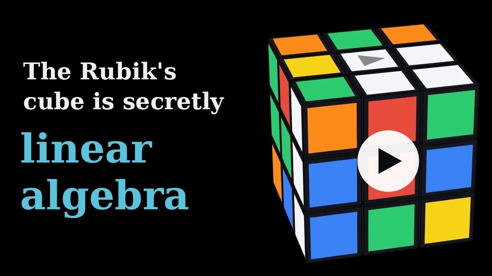

<p align="center">
  
</p>

<h1 align="center">Eigencube</h1>

> A **Functional Pearl**: A minimalistic Rubik's Cube solver in **under 400 lines of Python**, powered by **linear algebra**.

<p align="center">
  <a href="https://youtu.be/kRrK4VJBf2s"></a>
</p>

Most Rubik's cube solvers rely on complex combinatorial bookkeeping: tracking 54 color stickers mapped across flat arrays, maintaining lookup tables for permutations, or precomputing massive 100MB pattern databases.

**Eigencube takes a different path.** By framing the puzzle in discrete 3-dimensional Euclidean space using linear algebra, the entire physics, state, and solution of the Rubik's Cube reduce to **vectors, rotation matrices, and dot products**.

The payoff of this linear algebra formulation is **radical simplicity**: the entire puzzle model, transformations, and multi-phase solver in [`eigencube.py`](eigencube.py) fit in **under 400 lines of readable Python**—with zero external puzzle libraries, zero lookup tables, and zero precomputed pattern databases.

> [!NOTE]
> **Shoutout:** The core insight for Eigencube was directly sparked by Grant Sanderson’s ([3Blue1Brown](https://www.3blue1brown.com)) masterclass YouTube series, [**Essence of Linear Algebra**](https://www.youtube.com/playlist?list=PLZHQObOWTQDPD3MizzM2xVFitgF8hE_ab). The series’ emphasis on geometric intuition—treating matrices as transformations of coordinate space and tracking where standard basis vectors land—inspired ditching messy combinatorial sticker permutations in favor of discrete 3D rotation matrices, vectors, and inner products. Massive praise and props to Grant for making linear algebra so intuitive, visual, and delightful!

---

## The Math Behind the Magic

<!-- This table mirrors the film's closing recap (Outro in explainer/scenes.py); keep the two in step. -->
### The model at a glance

| Concept | In linear algebra |
|:--|:--|
| **Cubelets** | vectors $c \in \lbrace -1, 0, 1 \rbrace^3$: each cubelet's home address, from the fixed core |
| **Cubelet type** | $\lVert c \rVert_1 = \lvert x \rvert + \lvert y \rvert + \lvert z \rvert$ = number of stickers (core 0, center 1, edge 2, corner 3) |
| **Colors** | $\pm\mathbf{e}_x, \pm\mathbf{e}_y, \pm\mathbf{e}_z$: the never-moving centers, each an eigenvector of the turns around it |
| **Sticker colors** | the non-zero columns of $\mathrm{diag}(c)$ |
| **State** | one configuration $(c, R)$ per cubelet, with $R$ a rotation matrix |
| **Position** | $p = R\,c$: where the cubelet is now |
| **Sticker directions** | $R \cdot \mathrm{diag}(c)$: which way the cubelet's stickers face now |
| **Move** | the cubelets with $\mathbf{v} \cdot (R\,c) > 0$ turn ($\mathbf{v}$: the face's axis): $R \leftarrow M R$ ($M$: the quarter-turn matrix) |
| **Solved** | $R \cdot \mathrm{diag}(c) = \mathrm{diag}(c)$ for every cubelet |

---

## Solver Architecture

Finding the optimal solution to an arbitrary Rubik's cube is NP-hard, and God's Number (20 moves) requires massive precomputed pattern databases.

[`eigencube.py`](eigencube.py) implements a **hierarchical multi-phase A\* search** that mimics human layer-by-layer reduction, staying strictly under 400 lines without precomputed databases:

```
[Scrambled Cube]
       |
       v
Phase 1: Top Layer & Centers (17 cubelets)
       |
       v
Phase 2: Middle Layer Edges (4 cubelets)
       |
       v
Phase 3: Bottom Cross (4 edge orientations & positions)
       |
       v
Phase 4: Bottom Corners (4 corner placements & twists)
       |
       v
Phase 5: Endgame Permutation Alignment
       |
       v
 [Solved Cube]
```

### Guiding the Search: Distance Estimation
A\* needs a sense of direction so it doesn't search aimlessly. Rather than storing gigabytes of precomputed lookup tables, Eigencube calculates a quick distance estimate on the fly:
- **Individual cubelet distance (`min_moves_to_solved`):** Calculates how many 90° turns an isolated cubelet needs to reach its solved coordinate and orientation if no other cubelets were in the way.
- **Layer distance:** Combines the individual estimates of the active layer's target cubelets into a single distance score, pulling the search toward states where more cubelets are closer to home.
- **State caching:** Evaluates successor states with memoized transposition caching (`@functools.cache`).

### Search Performance & Randomized Restarts
- **Throughput:** Simulates ~50,000 moves/sec via vector dot products and memoized transposition caching.
- **Move-Budgeted Restarts:** To escape deep local plateaus in complex scrambles without storing massive precomputed pattern tables, A\* incorporates subtle priority randomization (`RANDOMIZE_SEARCH = True`) bounded by deterministic move budgets (`max_moves=100_000` with gentle $1.5\times$ expansion). Instead of wall-clock timers and OS signals, searches cut losses after exploring ~100k moves (~2s) and retry with fresh randomized weights without discarding prior layer progress. Typical scrambles solve in 5–25 seconds.

---

## Getting Started

### Prerequisites
- Python 3.10+
- Virtual environment (`venv`)

### Installation

```bash
# Clone the repository
git clone https://github.com/smolkaj/eigencube.git
cd eigencube

# Create and activate a virtual environment
python3 -m venv eigencube_env
source eigencube_env/bin/activate

# Install dependencies (numpy, pygame, Pillow)
pip install -r requirements.txt
```

### Docker

Docker provides a reproducible environment for the test suite and command-line
solver without installing Python dependencies on the host:

```bash
# Build the image
docker build -t eigencube .

# Run the complete test suite (the image's default command)
docker run --rm eigencube

# Run the command-line solver with the default seed
docker run --rm eigencube python eigencube.py

# Run the solver with a specific seed
docker run --rm eigencube python eigencube.py 123
```

The image uses Pygame's headless video driver. The interactive GUI is better
run from the virtual environment because it requires access to the host display.

---

## Usage

### 1. Interactive Pygame Visualizer

Launch the 2D cube net visualizer:

```bash
python eigencube_gui.py
```

- **Shuffle:** Click the **Shuffle** button to apply a 999-move scramble.
- **Solve:** Click the **Solve** button to run the A\* solver with a real-time progress bar.
- **Playback:**
  - `Right Arrow`: Step forward through the solution moves (hold to fast-forward at 15×).
  - `Left Arrow`: Step backward through the solution moves (rewind).

*(Looking for a web version? Check out the browser-based [3D WebGL Explorer](https://ci4o2.zapto.org/life/life-cube.html) featured in [Eigencube Offshoots](#eigencube-offshoots).)*

### 2. Command-Line Solvers

Solve a scrambled cube directly from the terminal across any implementation (all accept an optional integer random seed, defaulting to `42`):

```bash
# Python canonical reference (~15–25s):
python eigencube.py [seed]
python eigencube.py --benchmark          # Benchmark across 100 scrambles

# Ultra-fast Rust companion (~0.02s, >10M moves/sec):
cargo run --manifest-path rust_fast/Cargo.toml --release -- [seed]

# Textbook linear algebra Rust port (~1.5s):
cargo run --manifest-path rust_pretty/Cargo.toml --release -- [seed]

# OCaml typed functional pearl (~3–8s):
opam exec -- dune exec --root ocaml eigencube -- [seed]

# High-performance Zig companion (~0.02s–0.2s, >10M moves/sec):
(cd zig && zig build run -Doptimize=ReleaseFast -- [seed])
```

### 3. Programmatic Python API

Use `eigencube` as a lightweight puzzle simulation and solving library:

```python
from eigencube import solved_cube, shuffle, solve, describe_move, is_cube_solved, apply_move_to_cube

# Create a scrambled cube
scrambled = shuffle(solved_cube, iterations=1000, seed=42)
print("Is solved?", is_cube_solved(scrambled))  # False

# Compute solution moves
solution = solve(scrambled)
print(f"Solved in {len(solution)} moves:")
for move in solution:
    print(" -", describe_move(move))

# Apply solution and verify final state
final_cube = scrambled
for move in solution:
    final_cube = apply_move_to_cube(move, final_cube)
print("Is solved?", is_cube_solved(final_cube))  # True
```

---

## Testing

Run the test suite:

```bash
python3 -m unittest discover tests
```

The test suite covers:
- Representation invariants (cubelet counts, $L_1$ norms, canonical positions).
- Rotation matrix algebra (orthogonality $R^T R = I$, $\det(R) = 1$, axis preservation).
- Scramble reproducibility and seed determinism.
- End-to-end multi-phase solver execution on scrambled states.
- Headless GUI snapshot rendering verification.
- The explainer film's geometry helpers (skipped unless the film's dependencies are installed).

---

## Codebase Structure

```
eigencube/
├── eigencube.py            # Core solver & linear algebra model (< 400 lines, canonical)
├── eigencube_gui.py        # Pygame GUI with animated moves & step playback
├── explainer/              # Animated video explainer of the encoding (Manim)
├── ocaml/                  # Minimalistic OCaml port (< 400 lines)
├── rust_pretty/            # Minimalistic Rust port (< 400 lines, textbook math)
├── rust_fast/              # Ultra-high-performance Rust solver (>10M moves/sec, Cayley L1)
├── zig/                    # High-performance Zig port (~8M–13M moves/sec, comptime Cayley)
├── scripts/
│   └── generate_logo.py    # Logo, icons & GitHub social preview generator
├── tests/
│   ├── test_eigencube.py   # Unit test suite
│   └── test_explainer_kit.py   # The explainer film's geometry helpers
├── img/                # Logo, icons, the GUI's snapshot & the film's thumbnail
│   ├── explainer-thumbnail.jpg  # YouTube's thumbnail with a centered play button, linking to the film
│   ├── gui-preview.png     # Written by eigencube_gui.render_frame_to_image
│   ├── logo.svg            # Logo; generate_logo.py also writes the icons below
│   ├── apple-touch-icon.png
│   ├── favicon.ico
│   ├── icon.png            # GUI window icon
│   └── social-preview.png
├── fonts/              # Roboto, for the GUI and the logo generator
├── requirements.txt    # numpy, pygame, Pillow
└── README.md
```

---

## Language Ports

While [`eigencube.py`](eigencube.py) is the canonical reference implementation powering the visualizer, Eigencube welcomes self-contained ports of the core mathematical solver to other programming languages.

Each port or companion implementation lives in its own top-level directory:
- [`ocaml/`](ocaml/): A self-contained, typed functional pearl in OCaml (< 400 lines) using immutable association lists and $SO(3, \mathbb{Z})$ linear algebra. Run solver via `opam exec -- dune exec --root ocaml eigencube -- [seed]` and tests via `opam exec -- dune test --root ocaml`.
- [`rust_pretty/`](rust_pretty/): A self-contained, high-performance port in Rust (< 400 lines) faithfully translating the textbook discrete linear algebra and on-demand memoized heuristics. Run solver via `cargo run --manifest-path rust_pretty/Cargo.toml --release -- [seed]` and tests via `cargo test --manifest-path rust_pretty/Cargo.toml --release`.
- [`rust_fast/`](rust_fast/): A specialized ultra-high-performance companion in Rust (< 500 lines) exploiting the $SO(3, \mathbb{Z})$ finite rotation group (order 24), flat 26-byte states, L1-resident Cayley action tables, and precomputed heuristic lookups to achieve >10,000,000 moves/sec (~16x throughput speedup over `rust_pretty/`, solving scrambles in ~0.02s–0.03s). Run solver via `cargo run --manifest-path rust_fast/Cargo.toml --release -- [seed]` and tests via `cargo test --manifest-path rust_fast/Cargo.toml --release`.
- [`zig/`](zig/): A companion high-performance port in Zig exploiting first-class compile-time execution (`comptime`) to shift the entire $SO(3, \mathbb{Z})$ Cayley group, transition tensor, distance graphs, pruning tables, Zobrist differential tensor, F2L bottom-cross macro tables, and $A_4 \times \mathbb{Z}_3^3$ bottom-corner commutator tables into read-only binary data (`.rodata`) with zero runtime initialization cost. Employs flat 26-byte states, branchless differential Zobrist hashing, and dynamically expandable search buffers to achieve ~10M–13M moves/sec (solving scrambles in ~0.005s–0.05s). Run solver via `zig build run -Doptimize=ReleaseFast -- [seed]` and tests via `zig build test -Doptimize=ReleaseFast` from within `zig/`.

Each language port must be self-contained within its directory, faithfully preserve the discrete 3D linear algebra formulation and the $R \cdot \text{diag}(c) = \text{diag}(c)$ solved invariant, maintain zero external puzzle dependencies, and provide its own standalone test suite.

---

## Eigencube Offshoots

Eigencube has inspired brilliant community projects based on the same linear algebra model, carrying the idea far beyond this repository:

- **[Interactive 3D WebGL Explorer](https://ci4o2.zapto.org/life/life-cube.html)** by [@ci4ic4](https://github.com/ci4ic4) ([source in `ci4ic4/life`](https://github.com/ci4ic4/life)): A dependency-light browser port using Three.js. Renders the cube in 3D, runs the layer-by-layer A\* solver in client-side JavaScript, and lets you click any cubelet to inspect its live coordinate $c$, position $R c$, rotation matrix $R$, and sticker directions $R \cdot \mathrm{diag}(c)$ in real time.

---

## Invariants & Design Principles

- **Single source of truth:** Code, specifications, and design principles must each have exactly one canonical representation. `eigencube.py` is the canonical reference implementation of the solver and visualizer. Language ports (such as `ocaml/`) are self-contained companions that faithfully mirror this canonical model in other language ecosystems without duplicating or fragmenting the core application stack.
- **A Functional Pearl (Maximally elegant, simple, and educational):** Eigencube is designed in the tradition of a *functional pearl*—an elegant, instructive gem where the code is an executable mathematical specification. Code clarity, linear algebra transparency, and pedagogical beauty always trump micro-optimizations or clever programming tricks.
- **Self-documenting, transparent code:** Code should read as self-explanatory prose. Reject cryptic abbreviations, single-letter domain shorthand, or dense tuple indexing. Prefer clear, descriptive names (`left`, `top`, `bottom` rather than `L`, `U`, `D`) so anyone can understand the logic without an external decoder ring.
- **Zero ambient magic:** No obscure puzzle encodings or heavyweight dependencies. Pure vector and matrix arithmetic.
- **Strict code compactness:** The complete solver and domain model in `eigencube.py` (and in each reference language port) strictly stays below 400 lines of clean, readable code (with `rust_fast/` under 500 lines including its complete L1 Cayley group generators).
- **Headless-friendly:** GUI components decouple display initializers so importing `eigencube_gui` works seamlessly in headless CI/CD environments.
